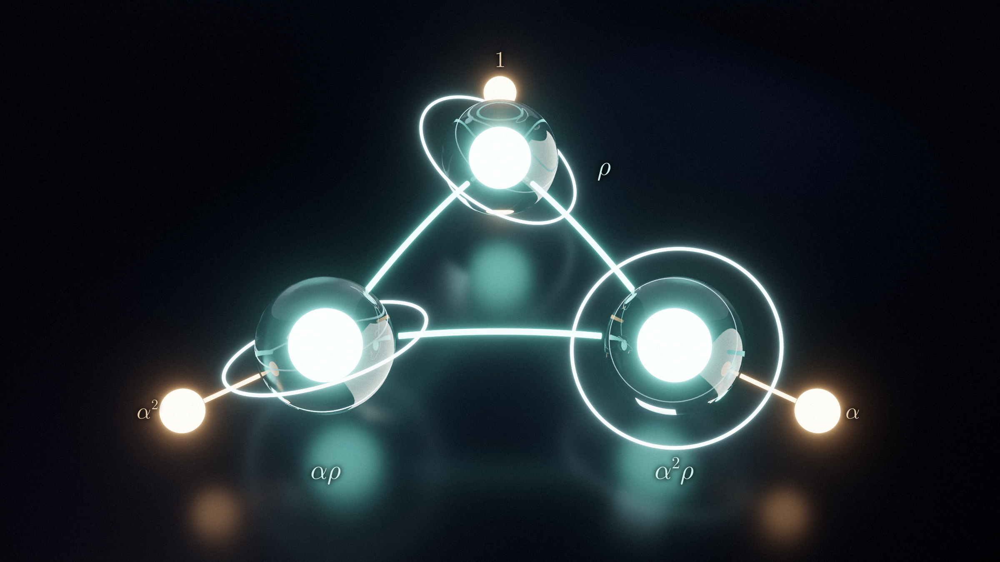
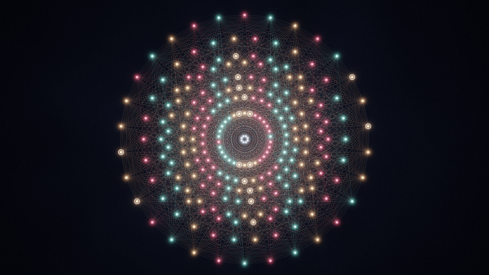
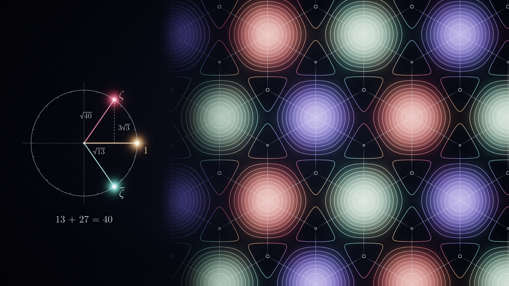
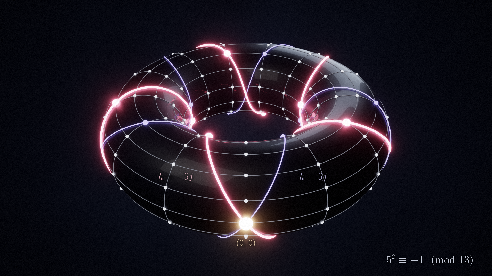
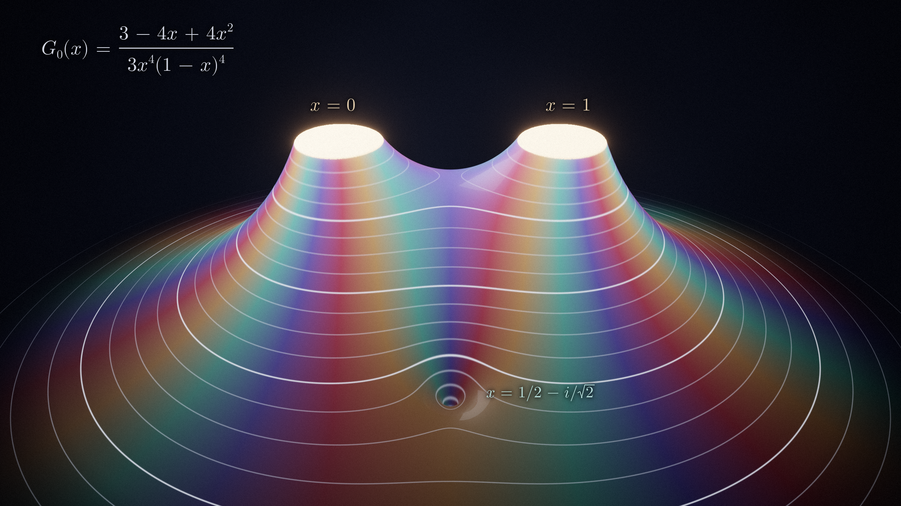
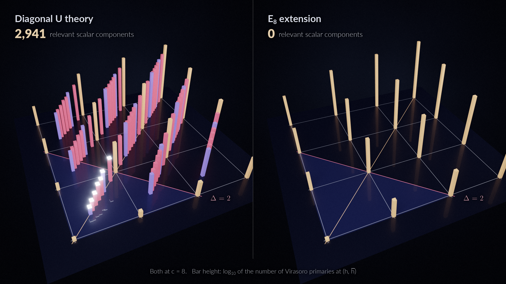

# Seven Views of Haagerup

*A gallery from the central-charge-eight Haagerup construction*

A conformal field theory with Haagerup symmetry, seen seven ways. Every image is drawn from exact data in the construction. The story under each one says what you are looking at and where it enters the work.

> The manuscript is a research draft. Its realization statements rest on explicit finite certificates recorded in its ledger. Exact replays check those identities, and no machine verification of the whole construction is claimed.

## 1. A symmetry with an irrational size

*The Haagerup category has six members. Three of them act like the rotations of a triangle. The other three each have size (3 + √13)/2.*

Ordinary symmetries form groups. Do two of them and you get a third, and every one can be undone. The Haagerup fusion category, which grew out of a subfactor that Uffe Haagerup identified in the early 1990s, has six simple objects that combine differently. Three of them, 1, *α* and *α*², compose like the rotations of a triangle, with *α*³ = 1. The other three obey *ρ* ⊗ *ρ* = 1 ⊕ *ρ* ⊕ *αρ* ⊕ *α*²*ρ*. Combining *ρ* with itself produces four objects at once, and nothing undoes it.

Each object has a size, its quantum dimension. Sizes multiply under ⊗ and add under ⊕, so the rule for *ρ* forces *d*² = 1 + 3*d*, and *d* = (3 + √13)/2 ≈ 3.303. A group element always has size one. That is why this symmetry does not fit inside any group, and why it has been hard to find in quantum field theory.

In the render each object is a sphere. A line joins two objects when one of them appears in *ρ* times the other. The sizes are not chosen by hand: they are the Perron–Frobenius eigenvector of this graph, and its eigenvalue is *d*. The ring around each teal sphere is a self-loop. It records that *ρ* occurs inside *ρ* ⊗ *ρ*.

In the manuscript these objects become topological lines in a unitary conformal field theory at *c* = 8. The chosen *E*₈ extension of the chiral algebra carries them, and a line can be wrapped around space and read as an operator. The line *ρ* multiplies the vacuum sector by *d* and the next sector, *b*, by −1/*d*.

**What you see.**

- Sphere radius is proportional to quantum dimension: 1 for the gold spheres (1, *α*, *α*²) and *d* ≈ 3.303 for the teal ones (*ρ*, *αρ*, *α*²*ρ*).
- Edges: *x* is joined to *y* when *y* occurs in *ρ* ⊗ *x*. So 1–*ρ*, *α*–*α*²*ρ*, *α*²–*αρ*, and every pair of teal spheres, including each with itself (the rings).
- Blender Cycles render: glass spheres with glowing cores on a fading lacquer floor.

**In the work.** Theorem 1.4, VOA realization and holomorphic extension (p. 6). Section 6, the Haagerup symmetry of the holomorphic extension (p. 23): the line actions and the twined trace Z^([ρ]) = (*d*χ₀ − *d*⁻¹χ_*b*)χ̅_*E*₈, eq. (73).

## 2. Hiding inside E₈

*The theory is built inside the most symmetric lattice in eight dimensions. Its 248 currents split three ways, and whether two of the parts agree decided the shape of the whole construction.*

The *E*₈ lattice gives a conformal field theory at central charge 8 with 248 conserved currents: eight along the Cartan directions and one for each of the 240 roots drawn here. The picture is the classic projection in which the roots fall on eight rings of thirty.

The construction starts one step down, in the sublattice *E*₆ ⊕ *A*₂ of index three. Its 78 roots are gold. The rest of *E*₈ splits into two cosets of 81 roots each, teal and coral. From the gold part the manuscript picks six currents, an sl₂ at level 1 and an sl₂ at level 39, whose roots are ringed in white. With the stress tensor and one more field *u* they generate the chiral algebra *U*.

Seen from *U*, the 248 currents regroup as 6 + 80 + 81 + 81. The 6 belong to *U*. The 80 fill out the rest of the gold part. The teal and coral 81s start two sectors, *Y* and *Y**.

The proof then turns on a yes-or-no question. Are *Y* and *Y** the same? If they differ, the symmetry left over has four objects. If they agree, it has six. The manuscript rules out four, so teal and coral carry the same sector. Further arguments identify the six-object ring as Haagerup, and the chosen *E*₈ extension restricts to *U* as *M*₀ ⊕ *M*_*b* ⊕ 2*M*_*a*.

**What you see.**

- All 240 roots of *E*₈, computed from the manuscript's own *E*₆ ⊕ *A*₂ Gram matrix and projected to the Coxeter plane (8 rings × 30).
- Colour is the ℤ₃ coset: 78 gold (*E*₆ ⊕ *A*₂), 81 teal, 81 coral. The 6,720 edges join roots at 60° and are drawn as additive light.
- White rings: the 16 roots ±*α*_*L* and ±*α*_*i* (*c*_*i* ≠ 0) used by *U*'s six currents. Centre: the 8 Cartan directions.

**In the work.** Appendix A and Lemma A.1, the lattice and the two affine levels (pp. 28–29). Section G.1, eqs. (112)–(113): *B*↓*U* = *U* ⊕ *X* and *H*↓*U* = 1 ⊕ *X* ⊕ *Y* ⊕ *Y**. Section G.2, eq. (114): the rank-four or rank-six fork. Section G.3: excluding rank four (p. 48).

## 3. One field, three waves

*Six currents and one extra field generate the whole theory. The field is a sum of three waves, and the arithmetic fact 13 + 27 = 40 fixes the phase between them.*

A lattice theory is built from waves. Each lattice vector *a* gives a field e^(*a*) that behaves like a plane wave with momentum *a*. The defining field of the construction adds three of them: *u* = e^(*a*₁) + ((√13 + 3√−3)/20) e^(*a*₂) + ((√13 − 3√−3)/20) e^(*a*₃).

Each momentum has squared length 4, and each pair meets at 60°. Together with the origin they form a regular tetrahedron. Measured from their centre, they are three wave vectors 120° apart. Three such waves interfere in a honeycomb. At the dark points the waves cancel, and the phase, shown as colour, winds once around each of them.

In the theory's positive inner product the three coefficients become 1, ζ and ζ̅, with ζ = (√13 + 3*i*√3)/√40. Its length is exactly 1 because 13 + 27 = 40. So there is no dial left to turn. The field carries both signature numbers of the theory, √13 from the Haagerup dimension and √−3 from the triangle of invertible objects. Its charges under the two current algebras are 1 and 13.

Everything else is computed inside the lattice theory. *U* has 6 states of weight one, 120 of weight two and 956 of weight three. The hard part of the proof is showing that *U* is proper: that no singular product of its higher fields ever creates a new current, at any weight. A finite strong-generation criterion settles this using exact identities over ℚ(√13, √−3).

**What you see.**

- Brightness: |*f*|²/9 for *f*(*x*) = e^(*ik*₁·*x*) + ζ e^(*ik*₂·*x*) + ζ̅ e^(*ik*₃·*x*), the classical profile of *u* on the plane its momenta span. Colour: arg *f*. Thin white lines: the phase in steps of π/3.
- The three phases multiply to 1, so the pattern is a translate of the one for equal phases. The invariant content is in the phasor diagram on the left.
- Left: the unit circle with 1, ζ and ζ̅, and the right triangle √13, 3√3, √40 scaled by 1/√40.

**In the work.** Eq. (83), the defining field, and its positive transport (Appendix A, p. 29). Certificate A.2, the constructed spaces in weights two and three (p. 30). Proposition 1.1 and Appendices B–E, strong generation and properness in all weights.

## 4. Five squared is minus one

*Deep inside the algebra sits a core glued from two well-known theories. The glue exists because 5 × 5 = 25 is one less than 2 × 13.*

To control every module of *U* at once, the proof looks for a smaller algebra inside it that is already understood. It finds one made of two pieces: a lattice–Potts core of central charge 14/5, and the level-13 parafermions of central charge 8/5. Each piece has simple currents labelled by residues mod 13. Together their labels (*j*, *k*) fill the 13 × 13 grid on this torus.

Two such currents can be glued into a larger algebra only if the combined spin is a whole number. For the label (*j*, *k*) the spin is −(*j*² + *k*²)/13 up to integers, so gluing needs *j*² + *k*² divisible by 13. Because 5² = 25 ≡ −1 (mod 13), the solutions are exactly the lines *k* = −5*j* and *k* = 5*j*. On the torus each line becomes a knot that goes once around the long way and five times around the tube.

The two lines cannot both be used, because together they generate labels with fractional spin. An exact field certificate supplies weight-two vectors in *U* with charge (5, 1), which lies on the coral line *k* = −5*j*. With the manuscript's orientation convention, that is the line realized. The result is a subalgebra whose representation category is Fib ⊠ SO(3)₁₃, with fourteen simple modules.

This core is what bounds the lowest weight of every *U*-module by 17/10, without assuming unitarity. That bound is the first step in pinning down all twelve sectors. The final lowest weights top out at 15/13.

**What you see.**

- The 169 labels (*j*, *k*) ∈ (ℤ/13)² placed on a torus. Coral: the isotropic line *k* = −5*j* (13 beads) and the continuous (1, −5) torus knot through them.
- Violet: the other isotropic line *k* = 5*j*, which cannot also occur. Gold: the vacuum (0, 0), the only label on both lines.
- Faint grid: the 13 + 13 coordinate circles. Blender Cycles render.

**In the work.** Section G.1, a universal top bound and actual lattice branching (pp. 44–46): the order-thirteen gluing, Rep(*A*_*L*) ≃ Fib ⊠ SO(3)₁₃, and the bound 0 ≤ *h* ≤ 17/10 in eq. (111).

## 5. Thirteen hours

*The theory has twelve kinds of particle. On a clock with thirteen hours, six of them sit exactly on the hours that are not perfect squares.*

A rational conformal field theory sorts its states into finitely many sectors. Here there are twelve, the simple objects of the Drinfeld center *Z*(*H*₃). Each has a twist, a phase set by its conformal weight. On a 13-hour clock the six sectors *d*₁, …, *d*₆ land at hours 6, 11, 2, 5, 7 and 8. These are exactly the non-squares mod 13. The squares 1, 3, 4, 9, 10 and 12 are the empty sockets. Two more sectors sit on a three-hour dial inside, and four with trivial twist sit at the centre.

Squares and non-squares mod 13 are the ingredients of a Gauss sum. Take twelve unit steps, the *j*-th in the direction of hour *j*: forwards if *j* is a square, backwards if not. The coral steps are the backward ones, at the same hours as the coral beads. The walk ends exactly at √13. The manuscript's defect code builds √13 this way. It then checks the modular data in exact arithmetic over ℚ(ζ₁₃): *S*² = 1, (*S*Θ)³ = 1, and all 1,728 fusion coefficients are non-negative integers.

The clock also fixes the characters. The modular data allow a family of character vectors, built from Evans and Gannon's fundamental matrix and indexed by an integer γ ≥ 0, and the member γ has 6 + 13γ currents. The construction has exactly six, so γ = 0, and the whole vector follows. The vacuum character begins *q*^(−1/3)(1 + 6*q* + 120*q*² + 956*q*³ + 6010*q*⁴ + ⋯).

One subtlety: the twist of *d*₃ points to hour 2, but its lowest weight is 15/13, not 2/13. The clock shows only the phase; the weight goes one full turn further.

**What you see.**

- Outer dial: sector *d*_*j* at hour 6*j*² mod 13, read off its twist e^(2π*i*·6*j*²/13). Hollow sockets: the quadratic residues.
- Inner dial: *c*₁ and *c*₂ at twists e^(2π*i*/3) and e^(4π*i*/3). Centre: 0, *b*, *a*, *c*₀ with twist 1.
- Bead area is proportional to quantum dimension: 1, *d*² ≈ 10.9, *s* = 2 + 3*d* ≈ 11.9, 3*d* ≈ 9.9. Right: partial sums of Σ (*j*/13) e^(2π*ij*/13), with (*j*/13) the Legendre symbol.

**In the work.** Section 5, modular data, topological defects and conformal boundaries (p. 20), with `c8_physics_20260927/defects.py`. Appendix H and Lemma H.1, the complete character vector and γ = 0 (p. 58).

## 6. The shape of a four-point function

*Modular data say which particles exist. Correlators say how they interact. This is the first exact one, drawn as a landscape.*

Place the field *u* and its conjugate at 0, *x*, 1 and infinity. The four-point function is then an exact rational function, *G*₀(*x*) = (3 − 4*x* + 4*x*²) / (3*x*⁴(1 − *x*)⁴). Each field is a sum of three exponentials, so the product has 81 terms. Charge conservation kills all but 15, and each survivor carries weight 1/9.

The landscape shows its size as height, on a log scale, and its phase as colour, over the complex *x*-plane. Where two operators collide, at *x* = 0 and *x* = 1, there are poles of order four. They rise as glowing calderas, and the colours wind four times around each. The two sinkholes at *x* = ½ ± *i*/√2 are the zeros. The mirror symmetry across Re *x* = ½ is crossing symmetry, *G*₀(1 − *x*) = *G*₀(*x*).

Expanding in conformal blocks gives the channel data 1, 8/3, 14/3, 58/9, 107/15, … The 8/3 = 1/2 + 13/6 is the exchange of the two Cartan currents, with the charges 1 and 13 again. The 14/3 splits as 1 for the stress tensor plus 11/3 for the other weight-two primaries. The same 11/3 comes out independently from the full table of 113 × 113 × 113 three-point couplings.

Data like these go beyond the torus partition function. A lattice model or a bootstrap study would need them to recognise this particular theory.

**What you see.**

- Height: log₁₀ |*G*₀(*x*)|, clipped at 10³ (the gold caldera floors) and 10^(−2.2) (the teal sinkhole floors). The real axis runs left to right; the window −2 ≤ Re *x* ≤ 3, |Im *x*| ≤ 2.1 fades out at its edge.
- Colour: arg *G*₀(*x*), cycling gold, coral, violet, teal. Thin contours every quarter decade, brighter every decade.
- Blender Cycles render of a height field with about 840,000 vertices.

**In the work.** Section 3, exact correlators and channel data (p. 13): eq. (28), the fifteen-term derivation and the global-block coefficients. The independent 11/3 cross-check is in `c8_physics_20260927/crosslink_checks.json`.

## 7. Two theories, one central charge

*The same chiral algebra builds two different worlds. Only one of them can be pushed off criticality by a relevant scalar.*

A chiral algebra does not by itself fix a full theory. Left and right movers still have to be paired. Pair each of *U*'s twelve sectors with itself and you get the diagonal theory on the left. Extend *U* to *E*₈ on both sides and you get the *E*₈ theory with Haagerup lines on the right. Both have *c* = 8 in each chirality. They have the same free energy, −4π*T*²/3*v* per unit length, and the same entanglement coefficient, 8/3.

Their spectra are very different. Each bar stands at a pair of conformal weights (*h*, *h̄*), and its height counts the Virasoro primaries there, from the exact spectrum computed through dimension 24. The diagonal theory crowds bars at thirds and thirteenths. Below the coral line Δ = 2, seven glowing scalar towers hold 9, 25, 49, 169, 196, 729 and 1,764 relevant scalars, 2,941 in all. The *E*₈ theory has integer weights only, and no scalar below the line.

The difference is physical. Relevant scalars are the knobs that drive a critical system away from criticality. In the ordinary modular bootstrap of Collier, Lin and Yin, the *E*₈ theory sits at the kink at (*c*, Δ) = (8, 2), while the diagonal theory sits deep inside the allowed region at (8, 2/3).

Yet the symmetry sees what they share. Keep only the states that every symmetry line leaves alone: the twelve Verlinde lines on the left, the Haagerup lines of the first *E*₈ factor on the right. In both, the first such scalar has dimension 2, with 36 components on the left and 1,488 on the right.

**What you see.**

- Bar at (*h*, *h̄*), height log₁₀(1 + number of Virasoro primaries). Weights up to 3 on each side, from the exported spectrum tables.
- Colour: gold for the integer-weight sectors (0, *b*, *a*, *c*₀), violet for *c*₁ and *c*₂, coral for *d*₁, …, *d*₆. White caps: the relevant scalars.
- Floor: the integer grid, the scalar diagonal *h* = *h̄* (gold) and the marginal line Δ = *h* + *h̄* = 2 (coral). Blender Cycles render.

**In the work.** Section 2, characters and a spin-resolved spectrum (p. 7), and eq. (10), the seven relevant scalar levels (p. 9). Section 7, coordinates for published exclusion plots (p. 26).
